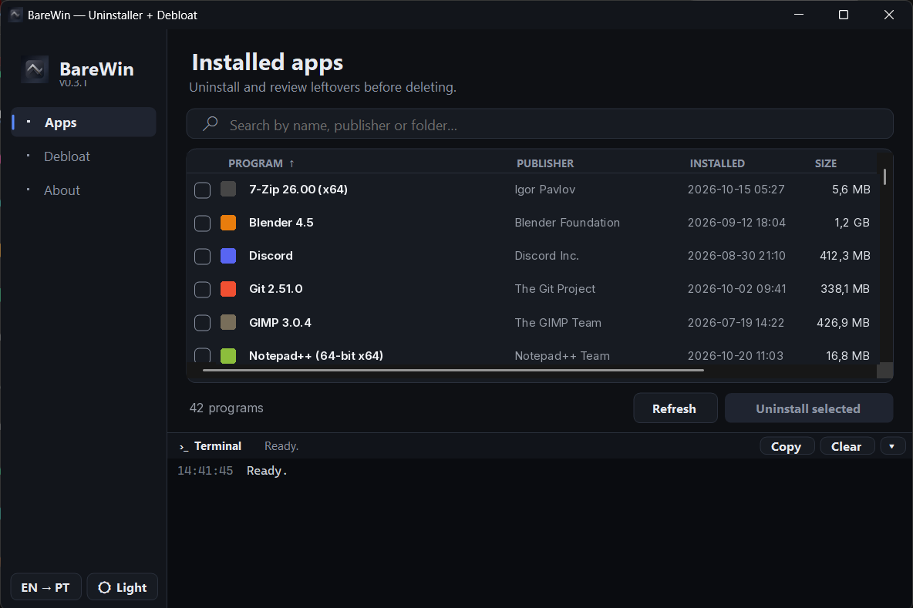
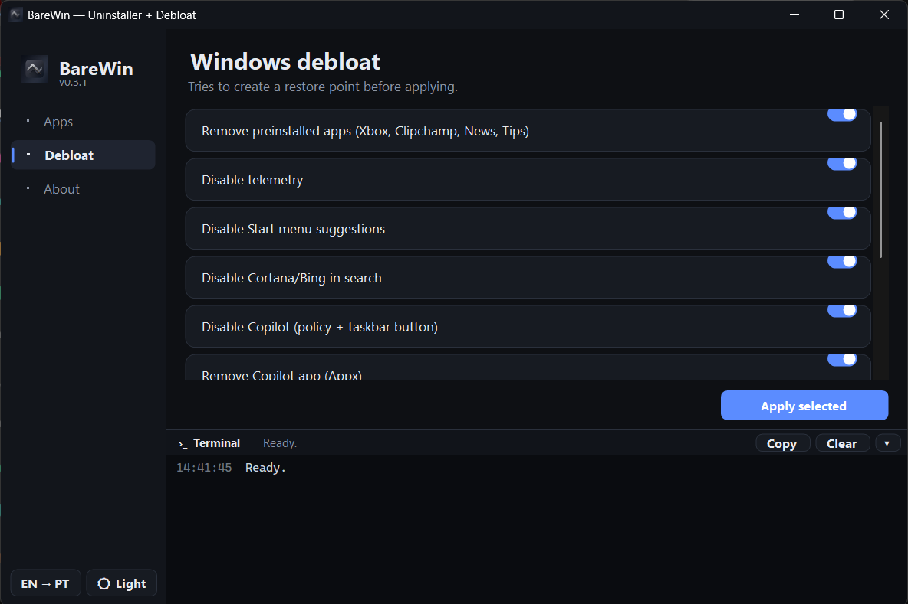
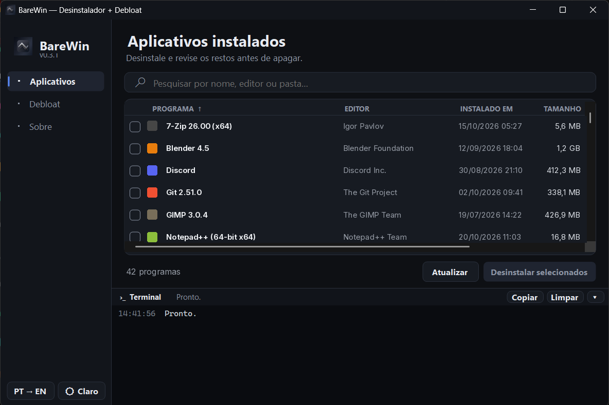
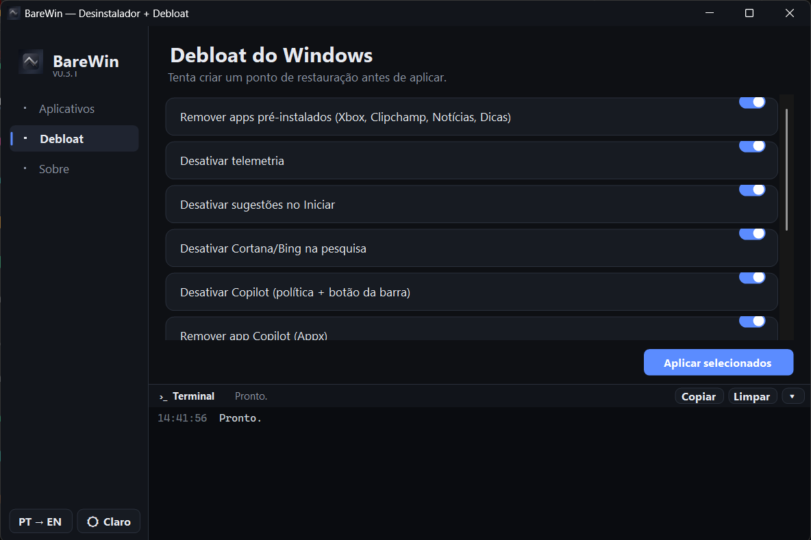

# BareWin

**Uninstaller + Debloat for Windows 10/11** · **Desinstalador + Debloat para Windows 10/11**

[English](#english) · [Português (BR)](#português-br)

<p align="center">
  
  
</p>

---

## English

BareWin is a small Windows utility to uninstall apps, preview leftover files, folders and registry keys before deleting them, and apply common debloat tweaks. Single portable `.exe` (self-contained, no .NET install needed) or MSI installer.

### Features
- Lists apps from the registry **and** loose program folders (e.g. Ollama in `%LOCALAPPDATA%\Programs`)
- App icon, install date/time, size, drive and folder · instant search · sortable columns
- Review leftovers (folders, files, registry keys) and choose what to delete
- Debloat: telemetry, Start suggestions, Bing/Cortana, Copilot, Edge background/Startup Boost, Windows animations, transparency, preinstalled apps
- Tries to create a restore point first; skips protected Windows SystemApps
- Live terminal showing every command and its output
- Dark / light theme · English / Português (BR)

### Download
Grab `BareWin-<version>.exe` or the `.msi` from [Releases](https://github.com/kkauaps/BareWin/releases). Run as administrator.

> Unsigned build: Windows SmartScreen may warn on first run ("More info" → "Run anyway").

### Build
Windows with .NET 8 SDK and WiX v4+:
```powershell
pwsh build.ps1
```
Outputs `dist\BareWin-<version>.exe` and `dist\BareWin-<version>-x64.msi`.

### License
[MIT](LICENSE)

---

## Português (BR)

BareWin é um utilitário pequeno para Windows que desinstala programas, mostra os restos (pastas, arquivos e chaves de registro) antes de apagar e aplica ajustes de debloat comuns. Um único `.exe` portátil (não precisa instalar .NET) ou instalador MSI.

<p align="center">
  
  
</p>

### Recursos
- Lista apps do registro **e** pastas de programas soltas (ex.: Ollama em `%LOCALAPPDATA%\Programs`)
- Ícone, data/hora de instalação, tamanho, disco e pasta · busca instantânea · colunas ordenáveis
- Revisão de restos (pastas, arquivos, registro) com escolha do que apagar
- Debloat: telemetria, sugestões do Iniciar, Bing/Cortana, Copilot, Edge em segundo plano/Startup Boost, animações, transparência, apps pré-instalados
- Tenta criar ponto de restauração antes; ignora SystemApps protegidos do Windows
- Terminal ao vivo com cada comando e sua saída
- Tema escuro / claro · English / Português (BR)

### Download
Baixe `BareWin-<versão>.exe` ou o `.msi` em [Releases](https://github.com/kkauaps/BareWin/releases). Execute como administrador.

> Build não assinado: o SmartScreen pode avisar na primeira execução ("Mais informações" → "Executar assim mesmo").

### Compilar
Windows com .NET 8 SDK e WiX v4+:
```powershell
pwsh build.ps1
```
Gera `dist\BareWin-<versão>.exe` e `dist\BareWin-<versão>-x64.msi`.

### Licença
[MIT](LICENSE)
